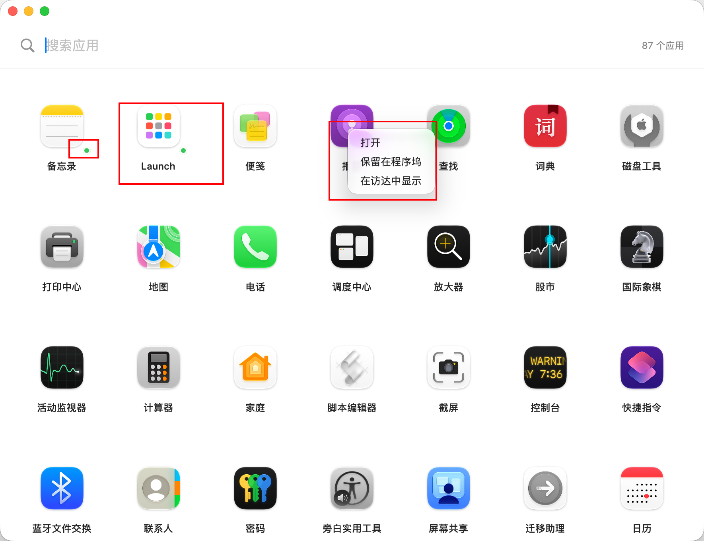

# MAC-Launch

一个精简的 macOS 应用启动器原型。

<p align="center">
  
</p>

## 下载

需要 macOS 14 或更高版本。根据 Mac 芯片下载对应版本：

- Apple Silicon（M 系列）：`Launch-1.0.6-arm64.zip`
- Intel Mac：`Launch-1.0.6-x86_64.zip`

[前往 Releases 下载](https://github.com/Stephen1993/MAC-Launch/releases/latest)

解压后将 App 拖入“应用程序”目录。当前构建使用本地临时签名，未经过 Apple 公证；如果首次启动被 macOS 阻止，请在 Finder 中右键 App，选择“打开”，再确认一次。

## 功能

1. **搜索 App**：自动扫描系统应用目录，输入名称即时筛选，右侧显示匹配数量；回车打开首个结果。
2. **自定义 App 顺序**：直接拖动图标调整位置，插入位置用竖线提示，松手后自动保存。
3. **滑动浏览更多 App**：七列纵向网格，可滚动查看全部应用；拖拽到窗口边缘时自动滚动。
4. **应用操作**：右键应用可打开、退出、保留在程序坞、在访达中显示或卸载；退出使用应用自身的正常退出流程，卸载会把应用移到废纸篓，仍可恢复。
5. **固定应用顺序**：已有 App 保持上次位置，更新不会前移；多个新 App 按添加时间倒序置顶。
6. **极致性能与安全**：纯白不透明窗口、无联网、无遥测、无菜单栏常驻图标；关闭窗口、切换应用或启动所选 App 后立即退出，不占用后台资源。

## 构建

需要 macOS 14+ 和 Swift 6 工具链（Command Line Tools 即可）。

构建脚本会生成两个独立的单架构版本：

- `dist/Launch-arm64.app`
- `dist/Launch-x86_64.app`

```bash
chmod +x scripts/build_app.sh
./scripts/build_app.sh
open dist/Launch-arm64.app   # Apple Silicon
open dist/Launch-x86_64.app  # Intel Mac
```

应用顺序保存在本机偏好设置中，更新不会改变已有 App 的位置。新安装的 App 会放在最前面，之后可继续手动拖拽调整。

## 许可证

本项目采用 [MIT License](LICENSE)。
